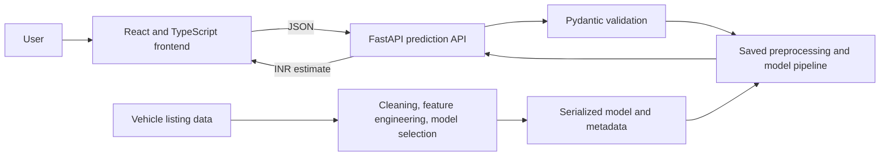

# MotorMind — Used Car Price Estimator

MotorMind is a full-stack machine learning application that estimates used-car listing prices in Indian rupees. It combines vehicle specifications with ownership, city, and seller details, then returns an estimate from a trained regression pipeline.

**Live project:** [Open MotorMind](https://vehicle-price-prediction-theta.vercel.app/) · [API documentation](https://vehicle-price-prediction-iuqu.onrender.com/docs) · [API health](https://vehicle-price-prediction-iuqu.onrender.com/api/health)

## Project overview

The application provides a responsive car valuation form backed by a FastAPI service. The service validates inputs, derives vehicle age from the year of purchase, applies the saved preprocessing and prediction pipeline, and returns an INR estimate.

### Product features

- Linked manufacturer and model selectors
- Year of purchase with automatic vehicle-age calculation
- Fuel, transmission, ownership, city, and seller selectors
- Numeric fields for kilometres driven, mileage, seating, horsepower, and engine capacity
- Prediction result with a summary of the submitted vehicle details
- Responsive React interface with a custom MotorMind favicon

## Architecture



At startup, the API loads the serialized scikit-learn pipeline and metadata. Prediction requests do not need the original CSV files or model retraining.

## Machine learning

**Prediction algorithm:** Tuned Random Forest Regressor (`RandomForestRegressor`). The target is the advertised listing price, `listed_price`.

The training workflow prepared 36,454 usable listings from the joined vehicle data and used an 80/20 train-test split with random seed 42. It compared a median baseline, Linear Regression, Decision Tree, Random Forest, and HistGradientBoosting. Candidates were ranked by three-fold cross-validation MAE. `RandomizedSearchCV` tuned four Random Forest configurations; the best pipeline was saved for inference.

### Input features

The model uses 13 features: company, model, fuel type, transmission, owner type, city, seller type, vehicle age, kilometres driven, mileage, seating capacity, horsepower, and engine capacity. Less common city values are grouped as `Other` based on the training data.

Preprocessing is part of the saved pipeline:

- Numeric fields use median imputation and `StandardScaler`.
- Categorical fields use most-frequent imputation and one-hot encoding with unknown-category handling.
- Regular expressions extract values and units from horsepower and mileage text. PS and kW values are converted to bhp; mileage is standardized to km/l records.

### Model selection results

Three-fold cross-validation MAE on the training partition:

| Candidate | CV MAE (INR) |
|---|---:|
| Tuned Random Forest — selected | ₹99,788 |
| Random Forest | ₹101,931 |
| HistGradientBoosting | ₹123,863 |
| Decision Tree | ₹124,817 |
| Linear Regression | ₹192,856 |
| Median baseline | ₹448,175 |

### Held-out evaluation

Results on 7,291 unseen listings:

| Metric | Result |
|---|---:|
| Mean absolute error (MAE) | ₹101,640 |
| Median absolute error | ₹49,241 |
| 90th-percentile absolute error | ₹188,878 |
| Root mean squared error (RMSE) | ₹949,560 |
| R² | 0.534 |

The typical absolute error is about ₹1.02 lakh, while the median absolute error is about ₹49,241. R² indicates moderate explanatory power, not an accuracy percentage. RMSE is much higher because a small number of very expensive listings produce large errors. These results support using MotorMind as a directional estimate for vehicles represented in the data, rather than as a formal appraisal.

## Technology

| Area | Tools |
|---|---|
| Frontend | React, TypeScript, Vite, Tailwind CSS |
| Backend | Python, FastAPI, Pydantic, Uvicorn |
| Machine learning | scikit-learn, pandas, NumPy, joblib |
| Hosting | Vercel (frontend), Render (API) |

## API

| Method | Route | Purpose |
|---|---|---|
| `GET` | `/api/health` | Service and model status |
| `GET` | `/api/options` | Vehicle catalog and supported selector values |
| `POST` | `/api/predict` | Validates vehicle details and returns an INR estimate |
| `GET` | `/docs` | Interactive API documentation |

## Repository structure

```text
backend/
  main.py                 FastAPI endpoints and inference
  schemas.py              Request and response validation
  train_model.py          Data preparation, evaluation, and training
  requirements.txt        Backend dependencies
frontend/
  src/                    React interface and API client
  public/favicon.svg      MotorMind browser icon
  package.json            Frontend scripts and dependencies
models/
  car_price_model.joblib  Saved preprocessing and prediction pipeline
  model_metadata.json    Feature order, selectors, and model details
notebooks/                Exploratory analysis
src/                      Supporting data and model utilities
tests/                    API and project checks
render.yaml               Render API service configuration
```

The trained model and metadata are included for inference. Large source listing CSVs are excluded from the GitHub repository; they are only needed to repeat the training workflow.

## Run locally

Requirements: Python 3.10+, Node.js, and npm.

Install backend dependencies from the project root:

```powershell
py -m pip install -r backend\requirements.txt
```

In one terminal, start the API:

```powershell
py -m uvicorn backend.main:app --reload --host 127.0.0.1 --port 8005
```

In another terminal, start the frontend:

```powershell
cd frontend
npm install
npm run dev
```

Open the local address printed by Vite, normally `http://127.0.0.1:5173`.
