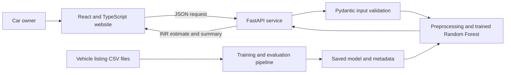

# MotorMind — Car Price Estimator

MotorMind is a full-stack machine-learning project that estimates used-car listing prices in Indian rupees. Its web form combines vehicle specifications with ownership, city, and seller information, then sends the selected details to a trained regression model.

**Algorithm used for predictions: Tuned Random Forest Regressor (`RandomForestRegressor`).** It predicts a continuous price in INR. Linear Regression, Decision Tree, HistGradientBoosting, and a median baseline were evaluated for comparison; they are not the deployed prediction model.

## Website features

- Manufacturer and model dropdowns linked to the vehicle catalog
- Purchase year converted to vehicle age using the model's 2026 reference year
- Fuel type and transmission dropdowns
- Previous-owner dropdown, including first through fifth owner
- City dropdown with the 100 most common dataset cities and an **Other** option
- Dealer or individual seller selection
- Positive numeric entry for kilometres driven, mileage, seating, horsepower, and engine capacity
- INR estimate with an itemized summary of the submitted details
- Responsive interface built with React, TypeScript, Vite, and Tailwind CSS

## Architecture



The API loads the saved pipeline and metadata at startup. Prediction requests do not read the CSV files or retrain the model.

## Project structure

```text
AIML_MINI_PROJECT/
├── backend/
│   ├── main.py                 # API endpoints and prediction logic
│   ├── schemas.py              # Validated API request and response types
│   ├── train_model.py          # Data preparation, model comparison, training
│   └── requirements.txt        # Python API and ML dependencies
├── Dataset/                    # Listing data and feature dictionary
├── frontend/
│   ├── src/                    # Website, components, API client, and types
│   ├── package.json
│   └── .env.example
├── models/
│   ├── car_price_model.joblib  # Trained preprocessing and model pipeline
│   ├── model_metadata.json     # Features, dropdowns, and evaluation metrics
│   ├── model_comparison.csv
│   └── test_predictions.csv
├── notebooks/                  # Project analysis notebook
├── src/                        # Supporting project utilities
└── tests/                      # Project checks
```

## Data and model

Training joins `Dataset/cars_details_merges.csv` with `Dataset/cars_data_clean.csv` by `usedCarSkuId`. The joined data contains 37,813 listings; after the training workflow excludes incomplete or invalid records, 36,454 remain. The target is the advertised `listed_price`.

The model uses 13 features: company, model, fuel type, transmission, owner type, city, seller type, vehicle age, kilometres driven, mileage, seating capacity, horsepower, and engine capacity. City values outside the 100 most common cities are grouped as **Other**. Categorical inputs are one-hot encoded and numeric inputs are scaled inside the saved scikit-learn pipeline.

The training workflow compared a median baseline, linear regression, decision tree, Random Forest, and HistGradientBoosting. A tuned Random Forest was selected using cross-validation MAE. The saved pipeline, feature order, dropdown options, and evaluation results are kept in `models/`.

## Algorithms and feature extraction

### Regression algorithms compared

The training script evaluated five regressors. It uses a three-fold cross-validation on the training partition and ranks candidates by mean absolute error (MAE):

| Algorithm | Three-fold CV MAE |
|---|---:|
| Tuned Random Forest | ₹99,788 |
| Random Forest | ₹101,930 |
| HistGradientBoosting | ₹123,863 |
| Decision Tree | ₹124,817 |
| Linear Regression | ₹192,856 |
| Median baseline (`DummyRegressor`) | ₹448,175 |

`RandomizedSearchCV` evaluates four hyperparameter combinations with three-fold CV. It tests model-specific settings such as tree count, maximum features, and minimum leaf size for Random Forest. Since tuning improved cross-validation MAE, the tuned Random Forest is the saved estimator. The split is 80% training and 20% testing, with random seed 42 for reproducibility.

### Text parsing and preprocessing

The source is already a structured vehicle dataset, so the project does not use OCR, a language model, or a general-purpose NLP text extractor. It uses regular expressions to extract the leading number and unit from text fields:

- **Horsepower:** reads values such as `88 bhp`, `90 PS`, or `66 kW`; converts PS and kW to bhp.
- **Mileage:** extracts the numeric value and unit, then keeps km/l (`kmpl`) records so different mileage units are not mixed.
- **Other fields:** converts year, kilometres, seating, and engine displacement to numeric values; trims and lowercases categorical labels.
- **City:** keeps the 100 most frequent normalized city values and maps less common cities to `Other`.

Within each training fold, the numeric pipeline uses median imputation and `StandardScaler`. The categorical pipeline uses most-frequent imputation and `OneHotEncoder` with unknown-category handling. These steps and the selected estimator are packaged together in the saved scikit-learn pipeline.

## Evaluation and what it means

Results below come from the current 20% held-out test split of 7,291 listings.

| Metric | Result | Interpretation |
|---|---:|---|
| Cross-validation MAE | ₹99,788 | Average absolute error during model selection |
| Test MAE | ₹101,640 | Average absolute error on unseen test listings |
| Median absolute error | ₹49,241 | Half of test predictions were within about this amount |
| 90th percentile absolute error | ₹188,878 | Nine out of ten test predictions were within about this amount |
| Test RMSE | ₹949,560 | Gives very large errors much more weight |
| Test R² | 0.534 | The model explains about 53.4% of price variation in this split |

MAE is the clearest summary of a typical miss: about ₹1.02 lakh on the test set. The test set's median listed price is ₹5.12 lakh, and its median absolute error is about ₹49,241. This suggests useful ballpark estimates for many listings in the represented market segment.

RMSE is much larger than MAE because the dataset has a long, expensive tail. For example, a ₹9.55 crore test listing was estimated at about ₹1.61 crore, a miss of about ₹7.95 crore. This is a real weakness for rare, exceptionally expensive cars and explains why RMSE is not representative of a typical prediction.

R² is not an accuracy percentage. A value of 0.534 indicates moderate explanatory power: the selected details capture a meaningful part of price differences, while substantial variation remains unexplained. Taken together, the results make MotorMind suitable as an educational project and an initial reference for comparing common used-car listings. The current evaluation does not support treating every output as a precise professional valuation or relying on it alone for a high-value decision.

## Run locally on Windows

You need Python 3.10 or later, Node.js, and npm. The project uses globally installed Python packages; a virtual environment is not required. The frontend connects to `http://127.0.0.1:8005` by default. Keep the backend and frontend running in separate terminals.

### 1. Install Python dependencies globally

From the project root, install the backend requirements into global Python:

```powershell
py -m pip install --upgrade pip
py -m pip install -r backend\requirements.txt
```

If `py` is not available, use `python` in its place. These global packages may also be used by other Python projects on your computer.

### 2. Install frontend packages

```powershell
cd frontend
npm install
Copy-Item .env.example .env
cd ..
```

### 3. Start the backend

From the project root, in the first terminal:

```powershell
python -m uvicorn backend.main:app --reload --host 127.0.0.1 --port 8005
```

If you use the Windows Python Launcher, use `py -m uvicorn` instead of `python -m uvicorn`.

### 4. Start the website

In a second terminal:

```powershell
cd frontend
npm run dev
```

Open the Vite address shown in the terminal, normally `http://127.0.0.1:5173`.

## API

| Method | Endpoint | Description |
|---|---|---|
| `GET` | `/api/health` | Reports whether the model is loaded |
| `GET` | `/api/options` | Returns supported dropdown choices and reference year |
| `POST` | `/api/predict` | Returns the estimated INR price and submitted inputs |
| `GET` | `/docs` | Interactive FastAPI documentation |

For example, check that the model has loaded:

```powershell
Invoke-RestMethod http://127.0.0.1:8005/api/health
```

The frontend API address is set by `VITE_API_BASE_URL` in `frontend/.env`. If you change it, restart the Vite development server. The backend's allowed frontend origins can be configured with `FRONTEND_ORIGINS`.

## Retrain and rebuild

To retrain after installing backend dependencies, run from the project root:

```powershell
python -m backend.train_model
```

Use `py -m backend.train_model` if you use the Windows Python Launcher. Training refreshes the model artifacts, comparison results, metadata, and held-out predictions under `models/`. Restart the API after training to load the updated model.

To create a production frontend build:

```powershell
cd frontend
npm run build
```

The built site is written to `frontend/dist/`.

To run the analysis notebook, install the additional packages from the root `requirements.txt`, then open `notebooks/car_price_prediction.ipynb` in Jupyter.

## Deploy online

The project includes [`render.yaml`](render.yaml) for its FastAPI service. Use Render for the API and Vercel for the static website; deploy them as separate services, then connect the website to the API.

### 1. Publish the project to GitHub

Create an empty GitHub repository, then run these commands from the project root, replacing the remote URL with your repository URL:

```powershell
git init
git add .
git status
git commit -m "Prepare MotorMind for deployment"
git branch -M main
git remote add origin https://github.com/YOUR-USERNAME/YOUR-REPOSITORY.git
git push -u origin main
```

The two training CSVs are excluded by `.gitignore`. They remain on your computer and are not needed to serve predictions: the API needs only `models/car_price_model.joblib` and `models/model_metadata.json`. The larger training CSV is 122 MB; GitHub blocks regular Git files above 100 MiB. To store the datasets in GitHub, use Git LFS instead.

### 2. Deploy the website on Vercel

Import the GitHub repository into Vercel and set the project root to `frontend`. Vercel detects Vite; use `npm run build` as the build command and `dist` as the output directory. The website can be deployed before the API so you can copy its public URL for the API's CORS setting.

After the first deploy, copy the Vercel site URL, such as `https://your-project.vercel.app`.

### 3. Deploy the API on Render

In Render, create a **Blueprint** from the GitHub repository and select the root `render.yaml`. When prompted for `FRONTEND_ORIGINS`, enter the Vercel site URL from the previous step. The blueprint installs the backend requirements, starts the API on Render's assigned port, and checks `/api/health`.

If creating a service manually, use these settings:

| Setting | Value |
|---|---|
| Root Directory | Repository root (leave blank) |
| Runtime | Python 3 |
| Build Command | `pip install -r backend/requirements.txt` |
| Start Command | `uvicorn backend.main:app --host 0.0.0.0 --port $PORT` |
| Health Check Path | `/api/health` |

Render requires a public web service to bind to `0.0.0.0` and its assigned port. The start command uses Render's `$PORT` value. When deployment finishes, copy the API's `https://...onrender.com` address.

### 4. Connect the website to the API

After Render finishes deploying, copy the API's `https://...onrender.com` address. In Vercel, add this environment variable for Production (and Preview if needed), then redeploy the frontend:

```text
VITE_API_BASE_URL=https://YOUR-API.onrender.com
```

Deploy the frontend and copy its public `https://...vercel.app` URL.

### 5. Verify the deployment

The Render blueprint uses the exact Vercel origin entered for `FRONTEND_ORIGINS`. Open the API's `/api/health` and `/api/options` endpoints, then submit a prediction from the Vercel website. If you change either hosted URL, update the corresponding environment variable and redeploy the affected service.

On Render's free web service, the API can spin down after 15 minutes without inbound traffic; the first request after that may take about a minute while it starts again. This is fine for a class demo, but a paid always-on service is more responsive for regular use.

Deployment references: [Render FastAPI guide](https://render.com/docs/deploy-fastapi), [Render web services](https://render.com/docs/web-services), [Vercel Vite guide](https://vercel.com/docs/frameworks/frontend/vite), [Vercel build settings](https://vercel.com/docs/builds/configure-a-build), and [GitHub large-file rules](https://docs.github.com/en/repositories/working-with-files/managing-large-files/about-large-files-on-github).
